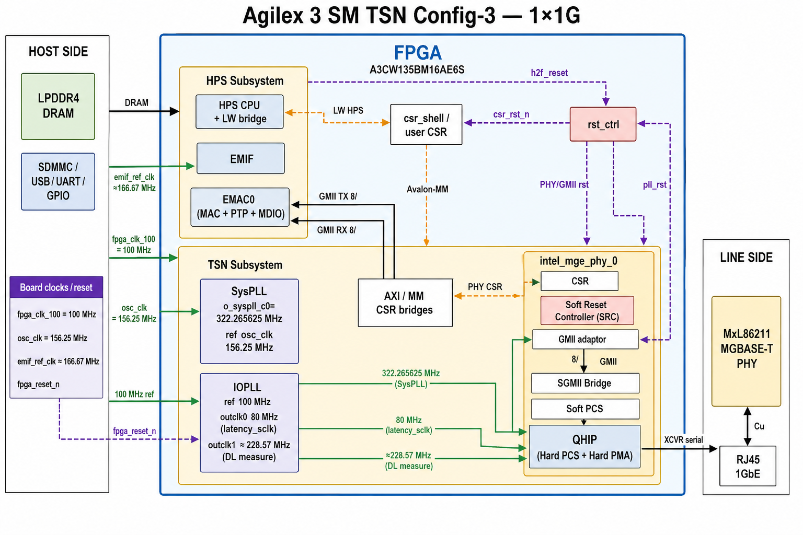

# HPS with Multi-rate Ethernet PHY System Example Design for Agilex™ 3 (SM TSN Config-3)

GHRD/GSRD-based example that adds a Multi-rate Ethernet PHY subsystem for TSN-capable Ethernet over XCVR. This tree is the **Agilex™ 3, 1×1G** variant (HPS EMAC0 ↔ GMII-8 ↔ MR PHY Direct ↔ MxL86211 MGBASE-T).

## Description

- One **1 GbE** port to the HPS (`NUM_PHY=1`); EMAC1/EMAC2 unused.
- Datapath: **HPS EMAC0 ↔ GMII (8-bit) ↔ Multi-rate Ethernet PHY (Direct mode) ↔ serial XCVR ↔ MxL86211** at **1G**.
- MR PHY: Direct PHY + GMII adapter (`ENABLE_GMII_ADAPTER=1`, `ENABLE_SGMII=0`, `EXT_PHY_MGBASET=1`).
- IEEE 1588 / PTP on MR PHY and HPS EMAC0.


The system block diagram is shown below:



## Repository structure

```bash
|--- doc
|--- src
|   |--- hw    # Quartus / VDS FPGA design
|   |--- sw    # Yocto GSRD layers
|   |--- sim   # UVM / ITF simulation (internal)
```

## Project details

| Item            | Value                                                                                                 |
| --------------- | ----------------------------------------------------------------------------------------------------- |
| Family          | Agilex 3                                                                                              |
| Quartus version | 26.1.0 Pro (last HW compile)                                                                          |
| Development kit | Agilex™ 3 FPGA E-Series Premium Development Kit (A3CW)                                               |
| Device part     | `A3CW135BM16AE6S`                                                                                   |
| Ethernet        | 1× 1G, MR PHY Direct + GMII-8 + MGBASE-T (MxL86211)                                                  |
| Category        | HPS, Ethernet, TSN                                                                                    |
| Design support  | Simulation, Compile/Timing, Hardware                                                                  |
| Source          | GitHub                                                                                                |
| URL             | https://github.com/altera-fpga/agilex3-ed-tsn-sgmii |

## Getting started

- [HW build README](src/hw/dk-a3w135bm16aea/README.md)
- [SW build README](src/sw/README.md)
- [Simulation README](src/sim/README.md)
